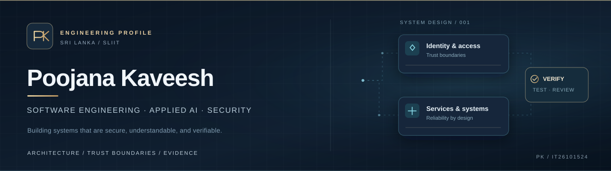

### BSc (Hons) Information Technology Undergraduate · SLIIT, Sri Lanka

I develop and study **backend platforms, secure applications and AI-enabled products** — with an emphasis on architecture, practical verification and user experience.

[**Portfolio ↗**](https://poojana-portfolio.vercel.app/) &nbsp;·&nbsp; [**LinkedIn ↗**](https://www.linkedin.com/in/poojana-kaveesh-3048b8387) &nbsp;·&nbsp; [**Engineering GitHub ↗**](https://github.com/teldigi5-wq) &nbsp;·&nbsp; [**CV ↗**](https://poojana-portfolio.vercel.app/assets/Poojana_Kaveesh_CV.pdf)

**Open to software engineering, backend and platform engineering internships.**

---

## Engineering, with evidence

I'm Poojana — an IT undergraduate interested in the intersection of **distributed systems, application security and applied AI**. My work spans Java services, Python, full-stack web applications and embedded systems. I value explicit trust boundaries, testable behavior, understandable failure modes and clear documentation.

This is my **SLIIT student GitHub account**. Most of my publicly reviewable engineering projects are published on my separate [primary GitHub account](https://github.com/teldigi5-wq); they are linked below rather than duplicated here.

## Selected projects

| Project | What it demonstrates | Evidence and scope |
| :--- | :--- | :--- |
| **[Aetheris Platform](https://github.com/teldigi5-wq/aetheris-platform)** *Distributed backend and AI-system foundations* | Java/Spring Boot services, identity boundaries, messaging, persistence and observability. | [Architecture decisions](https://github.com/teldigi5-wq/aetheris-platform/blob/main/docs/architecture-decisions.md) · [Verification checklist](https://github.com/teldigi5-wq/aetheris-platform/blob/main/docs/verification-checklist.md). Hardware-backed integration validation remains in progress. |
| **[FloodGuard](https://github.com/teldigi5-wq/floodguard-website)** *IoT and responsible telemetry* | Arduino/ESP8266 sensing, Firebase telemetry and a web dashboard that distinguishes live from last-recorded readings. | [System source](https://github.com/teldigi5-wq/floodguard-whatsapp-bot) · [Website](https://github.com/teldigi5-wq/floodguard-website). Educational prototype, not an emergency-warning system. |
| **[FinalForge](https://github.com/teldigi5-wq/finalforge)** *Student product and secure onboarding* | Revision workflows, mock assessments, allowlisted student access, email verification and Firebase integration. | [Repository](https://github.com/teldigi5-wq/finalforge) · [Checks](https://github.com/teldigi5-wq/finalforge/actions). Access-control assurance requires deployment-level review. |
| **[SENTINEL](https://github.com/teldigi5-wq/sentinel-security-platform)** *Security engineering lab* | Signed event ingestion, replay defenses, deterministic detection and traceable evidence workflows. | [Threat model](https://github.com/teldigi5-wq/sentinel-security-platform/blob/main/docs/THREAT_MODEL.md) · [Tests](https://github.com/teldigi5-wq/sentinel-security-platform/tree/main/backend/tests). Local pre-production research, not an endpoint-security product. |
| **[Averis AI](https://github.com/teldigi5-wq/averis-ai)** *Reviewable AI-adjacent analysis* | Document comparison, API workflows and private analysis-history design. | [Architecture](https://github.com/teldigi5-wq/averis-ai/blob/main/docs/ARCHITECTURE.md) · [CI](https://github.com/teldigi5-wq/averis-ai/actions). Similarity is not proof of plagiarism or AI authorship. |

### Current focus — Aetheris BoundaryLab

Exploring an **authorization-security verification platform** for SaaS applications: checking whether users, roles and tenants can access only what they should. The direction prioritizes **reproducible evidence, safe test execution, least-privilege integration and developer-friendly reports**.

*Status: early-stage product engineering and CI experiments. Commercial readiness, coverage and security efficacy have not been established.*

## Technical toolkit

**Backend &amp; architecture**  
     

**Product &amp; frontend**  
   

**Delivery, quality &amp; security**  
`Git & GitHub Actions` · `CI testing` · `REST APIs` · `JWT / access control` · `Threat modeling` · `Observability`

Technologies reflect project use and areas under active study, not claims of professional certification or mastery.

## Engineering principles

- **Design for trust:** validate inputs, define authorization boundaries and minimize privileges.
- **Make behavior verifiable:** keep tests, architecture notes and limitations alongside source code.
- **Build for users:** design accessible, responsive experiences with transparent system states.
- **Keep improving:** evaluate trade-offs, review failure cases and strengthen implementations incrementally.

---

**Let's build software that stands up to scrutiny.**

[Portfolio](https://poojana-portfolio.vercel.app/) · [LinkedIn](https://www.linkedin.com/in/poojana-kaveesh-3048b8387) · [Contact via email](mailto:teldigi5@gmail.com)

Student account: <a href="https://github.com/IT26101524">IT26101524</a> · Primary engineering account: <a href="https://github.com/teldigi5-wq">teldigi5-wq</a>

