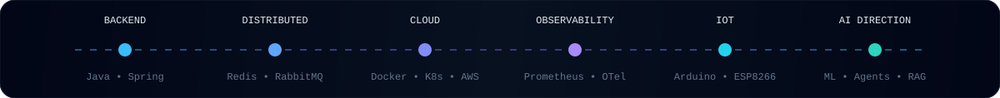

<div align="center">



### Software Engineering Undergraduate · Backend &amp; Platform Systems · Applied AI · Security

**BSc (Hons) Information Technology undergraduate — SLIIT, Sri Lanka**

I build software with **thoughtful system boundaries, security-first design, observable behaviour and premium user experience**.

<p>
  <a href="https://poojana-portfolio.vercel.app/"></a>
  <a href="https://www.linkedin.com/in/poojana-kaveesh-3048b8387"></a>
  <a href="https://poojana-portfolio.vercel.app/assets/Poojana_Kaveesh_CV.pdf"></a>
  <a href="https://github.com/teldigi5-wq"></a>
</p>

**Open to software engineering, backend and platform engineering internships.**



<p>
  <a href="#-featured-engineering-work"></a>
  <a href="#-engineering-evidence"></a>
  <a href="#-technical-toolkit"></a>
</p>

</div>

---

## 👤 About Me

<table>
<tr>
<td width="150" valign="top">

</td>
<td valign="top">

I'm **Poojana**, an Information Technology undergraduate at **SLIIT** who enjoys creating systems that are useful beyond a demonstration.

My interests include **Java/Spring backend engineering, AI applications, cybersecurity, system design and premium frontend experiences**. I'm currently sharpening fundamentals through university studies, practical projects, architecture reviews and testing.

**Two accounts, one engineering journey:** this is my [SLIIT student account](https://github.com/IT26101524). My larger public portfolio and project source live on [teldigi5-wq](https://github.com/teldigi5-wq). I link to them rather than copying code or overstating contribution history.

</td>
</tr>
</table>

---

## 🚀 Featured Engineering Work

*Real engineering questions, implementation evidence and transparent maturity boundaries.*

| Project | Engineering highlights | Evidence & status |
| :-- | :-- | :-- |
| **[Aetheris Platform](https://github.com/teldigi5-wq/aetheris-platform)** <br> Backend • Distributed systems | Java/Spring services, gateway, identity, messaging, persistence, observability and explicit AI-runtime separation. | [Architecture](https://github.com/teldigi5-wq/aetheris-platform/blob/main/docs/architecture-decisions.md) · [Verification checklist](https://github.com/teldigi5-wq/aetheris-platform/blob/main/docs/verification-checklist.md) · Integration/hardware validation ongoing. |
| **[FloodGuard](https://github.com/teldigi5-wq/floodguard-website)** <br> IoT • Real-world telemetry | Arduino/ESP8266 sensing, Firebase telemetry, monitoring dashboard and honest live/last-recorded data states. | [Website](https://github.com/teldigi5-wq/floodguard-website) · [Field/alert source](https://github.com/teldigi5-wq/floodguard-whatsapp-bot) · Educational prototype, not emergency infrastructure. |
| **[FinalForge](https://github.com/teldigi5-wq/finalforge)** <br> Full-stack • Education | Revision tools, mock assessments, verified student onboarding and Firebase-backed application workflows. | [Source](https://github.com/teldigi5-wq/finalforge) · [CI workflows](https://github.com/teldigi5-wq/finalforge/actions) · Deployment security requires independent verification. |
| **[SENTINEL](https://github.com/teldigi5-wq/sentinel-security-platform)** <br> Security • Detection | Signed telemetry ingestion, replay-resistant requests, deterministic detection and linked event evidence. | [Threat model](https://github.com/teldigi5-wq/sentinel-security-platform/blob/main/docs/THREAT_MODEL.md) · [Tests](https://github.com/teldigi5-wq/sentinel-security-platform/tree/main/backend/tests) · Local pre-production lab. |

**More work:** [Averis AI](https://github.com/teldigi5-wq/averis-ai) (document-comparison workflows) · [Wayfarer](https://github.com/teldigi5-wq/wayfarer-world-travel) (travel product UX) · [Aetheris AI Runtime](https://github.com/teldigi5-wq/aetheris-ai-runtime) (separate runtime research).

---

## 🔐 Current Focus — Aetheris BoundaryLab

**A proposed developer-facing authorization security verification platform.** The goal is to help SaaS teams check whether users, roles and tenants can access only their intended resources.

```text
Application roles and tenant boundaries
                 │
        Controlled test cases
                 │
     Authorization verification
                 │
         Reviewable evidence
                 ▼
       Developer-ready findings
```

The engineering direction prioritizes **safe test execution, least-privilege access, CI-compatible workflows and reproducible findings**. This is early-stage development; no finished commercial product or proven security coverage is claimed.

[View student CI repository](https://github.com/IT26101524/aetheris-boundarylab-ci) *(private repository; only accessible to authorized collaborators)*

---

## ✅ Engineering Evidence

I prefer implementation that can be inspected and explained over attractive but unverified claims.

| Engineering practice | Where to look |
| :-- | :-- |
| **Architecture and service design** | [Aetheris architecture decisions](https://github.com/teldigi5-wq/aetheris-platform/blob/main/docs/architecture-decisions.md) |
| **Test plans and verification** | [Aetheris verification checklist](https://github.com/teldigi5-wq/aetheris-platform/blob/main/docs/verification-checklist.md) |
| **Security threats and defenses** | [SENTINEL threat model](https://github.com/teldigi5-wq/sentinel-security-platform/blob/main/docs/THREAT_MODEL.md) · [backend tests](https://github.com/teldigi5-wq/sentinel-security-platform/tree/main/backend/tests) |
| **User-oriented delivery** | [FinalForge](https://github.com/teldigi5-wq/finalforge) · [Wayfarer](https://github.com/teldigi5-wq/wayfarer-world-travel) |
| **Physical-to-cloud data** | [FloodGuard source](https://github.com/teldigi5-wq/floodguard-whatsapp-bot) · [website source](https://github.com/teldigi5-wq/floodguard-website) |

---

## 🧰 Technical Toolkit

<div align="center">

**BACKEND & PLATFORM ENGINEERING**


<sub>Java · Spring Boot · Python · FastAPI · PostgreSQL · Redis · RabbitMQ · Docker · Kubernetes · Linux</sub>

<br><br>

**FULL-STACK & PRODUCT ENGINEERING**


<sub>Next.js · React · TypeScript · JavaScript · Node.js · Electron · Flutter · Dart · HTML · CSS</sub>

<br><br>

**CLOUD, DATA & EMBEDDED SYSTEMS**


<sub>AWS · Firebase · Supabase · Git · GitHub Actions · Arduino/ESP8266 · Vite</sub>

</div>

<sub>These are technologies used in projects and/or being studied, not a claim of mastery or official vendor certification.</sub>

---

## ✨ How I Approach Engineering

**Security by design** · Role boundaries, request validation, least privilege and responsible secrets management.

**Evidence over claims** · Tests, architecture notes, CI checks, repeatable investigations and visible limitations.

**Reliability by design** · Fail-safe defaults, observability, graceful degradation and maintainable interfaces.

**Experience with purpose** · Accessible navigation, thoughtful motion, responsive layouts and accurate data states.

---

<div align="center">

### Build with intent. Verify with evidence.

[**Portfolio**](https://poojana-portfolio.vercel.app/) &nbsp;·&nbsp; [**LinkedIn**](https://www.linkedin.com/in/poojana-kaveesh-3048b8387) &nbsp;·&nbsp; [**Email**](mailto:teldigi5@gmail.com) &nbsp;·&nbsp; [**Primary GitHub**](https://github.com/teldigi5-wq)

<sub>© Poojana Kaveesh · Student GitHub: IT26101524 · Engineering portfolio: teldigi5-wq</sub>

</div>
