**BSc (Hons) Information Technology Undergraduate · SLIIT, Sri Lanka**

*Backend engineering · Applied AI · Application security · Full-stack products*

  
  
  
  

**Open to software engineering, backend, and platform engineering internships.**

---

## About

I'm **Poojana**, an Information Technology undergraduate at **SLIIT**. I enjoy engineering applications with clear architecture, robust access controls, verifiable behavior, and a polished experience for real users.

This is my **student GitHub account**. Most public engineering work is hosted separately on my [primary account](https://github.com/teldigi5-wq), and I link directly to the project evidence below.

## Selected engineering work

| Project | Engineering focus | Inspect |
| :--- | :--- | :--- |
| **[Aetheris Platform](https://github.com/teldigi5-wq/aetheris-platform)** | Java/Spring Boot backend services, identity boundaries, asynchronous messaging and observability. Runtime integration validation continues. | [Architecture](https://github.com/teldigi5-wq/aetheris-platform/blob/main/docs/architecture-decisions.md) · [Verification](https://github.com/teldigi5-wq/aetheris-platform/blob/main/docs/verification-checklist.md) |
| **[FinalForge](https://github.com/teldigi5-wq/finalforge)** | Student learning platform with verified academic onboarding, assessments and Firebase integration. | [Source](https://github.com/teldigi5-wq/finalforge) · [CI](https://github.com/teldigi5-wq/finalforge/actions) |
| **[FloodGuard](https://github.com/teldigi5-wq/floodguard-website)** | Educational Arduino/ESP8266 IoT prototype, Firebase telemetry, and a responsive monitoring dashboard. Not a certified flood-warning system. | [Website](https://github.com/teldigi5-wq/floodguard-website) · [Telemetry](https://github.com/teldigi5-wq/floodguard-whatsapp-bot) |
| **[SENTINEL](https://github.com/teldigi5-wq/sentinel-security-platform)** | Local-first security research: authenticated telemetry, deterministic alert rules and reviewable event evidence. Pre-production. | [Threat model](https://github.com/teldigi5-wq/sentinel-security-platform/blob/main/docs/THREAT_MODEL.md) · [Tests](https://github.com/teldigi5-wq/sentinel-security-platform/tree/main/backend/tests) |

## Technical toolkit

**Backend &amp; systems**

 

**Frontend &amp; product development**

 

**Cloud &amp; developer tools**

Tools reflect project usage and subjects currently being studied, not vendor certification or expertise in every tool.

## Current direction

**Aetheris BoundaryLab** — early-stage research into reproducible authorization testing for role-based and multi-tenant SaaS applications, with emphasis on safe verification, meaningful evidence and CI integration. Security coverage and production readiness remain unverified.

## Engineering values

**Security by design** · **Evidence over assumptions** · **Accessible user experiences** · **Maintainable architecture**

---

[Portfolio](https://poojana-portfolio.vercel.app/) · [LinkedIn](https://www.linkedin.com/in/poojana-kaveesh-3048b8387) · [Email](mailto:teldigi5@gmail.com) · [Main projects](https://github.com/teldigi5-wq?tab=repositories)

IT26101524 — Academic GitHub · Poojana Kaveesh

