**POOJANA KAVEESH** &nbsp; / &nbsp; SLIIT INFORMATION TECHNOLOGY UNDERGRADUATE

*Software engineering · Backend systems · Applied AI · Application security*

[PORTFOLIO ↗](https://poojana-portfolio.vercel.app/) &nbsp;&nbsp; · &nbsp;&nbsp; [LINKEDIN ↗](https://www.linkedin.com/in/poojana-kaveesh-3048b8387) &nbsp;&nbsp; · &nbsp;&nbsp; [RESUME ↗](https://poojana-portfolio.vercel.app/assets/Poojana_Kaveesh_CV.pdf) &nbsp;&nbsp; · &nbsp;&nbsp; [ENGINEERING GITHUB ↗](https://github.com/teldigi5-wq)

---

### 01 / THE INTRODUCTION

## Building with intention.

I'm **Poojana**, a BSc (Hons) Information Technology undergraduate at **SLIIT, Sri Lanka**. My work sits at the intersection of **software engineering, product design and trustworthy systems**.

I enjoy translating ideas into working software: from Java/Spring backend services and security-focused experiments to IoT platforms, educational products and thoughtfully designed interfaces. I care equally about **how a product feels** and **how its implementation holds up to scrutiny**.

**Currently seeking software engineering, backend and platform engineering internship opportunities.**

> **A note on the two accounts:** This is my student profile, **[IT26101524](https://github.com/IT26101524)**. The larger project codebase and publicly reviewable evidence are maintained on **[teldigi5-wq](https://github.com/teldigi5-wq)**. They remain separate accounts.

---

### 02 / THE PRACTICE

## Three disciplines. One approach.

<table>
<tr>
<td width="33%" valign="top">
<strong>01 — DESIGN</strong>

Crafting clear, responsive product experiences where information, motion and interaction serve the user.

Frontend · UI/UX · Accessibility
</td>
<td width="33%" valign="top">
<strong>02 — ENGINEER</strong>

Exploring dependable service boundaries, maintainable architecture, testing and observable application behavior.

Java · Python · APIs · Systems
</td>
<td width="33%" valign="top">
<strong>03 — DEFEND</strong>

Reasoning carefully about trust, authorization, data exposure and the evidence needed to verify security claims.

AppSec · Access control · Assurance
</td>
</tr>
</table>

---

### 03 / SELECTED WORK

## A portfolio of problems worth solving.

Selected public projects from my main engineering account. Implementation scope and limitations are deliberately stated.

<table>
<tr>
<td width="9%" valign="top"><strong>01</strong></td>
<td width="30%" valign="top"><strong><a href="https://github.com/teldigi5-wq/aetheris-platform">AETHERIS</a></strong> DISTRIBUTED PLATFORMS</td>
<td valign="top">Java/Spring platform foundations covering identity, messaging, observability and an explicitly separated AI runtime. <a href="https://github.com/teldigi5-wq/aetheris-platform/blob/main/docs/architecture-decisions.md">Architecture ↗</a>
Research and integration validation in progress.
</td>
</tr>
<tr>
<td width="9%" valign="top"><strong>02</strong></td>
<td width="30%" valign="top"><strong><a href="https://github.com/teldigi5-wq/floodguard-website">FLOODGUARD</a></strong> IoT + HUMAN-CENTERED DATA</td>
<td valign="top">Arduino/ESP8266 telemetry, Firebase integration and a dashboard that distinguishes live from last-recorded data. <a href="https://github.com/teldigi5-wq/floodguard-whatsapp-bot">Field integration ↗</a>
Educational prototype; not an emergency warning system.
</td>
</tr>
<tr>
<td width="9%" valign="top"><strong>03</strong></td>
<td width="30%" valign="top"><strong><a href="https://github.com/teldigi5-wq/finalforge">FINALFORGE</a></strong> EDUCATION PRODUCT</td>
<td valign="top">Study and assessment platform with student access verification, mock exams, revision and Firebase-backed workflows. <a href="https://github.com/teldigi5-wq/finalforge/actions">CI evidence ↗</a>
Deployment security requires independent review.
</td>
</tr>
<tr>
<td width="9%" valign="top"><strong>04</strong></td>
<td width="30%" valign="top"><strong><a href="https://github.com/teldigi5-wq/sentinel-security-platform">SENTINEL</a></strong> SECURITY ENGINEERING</td>
<td valign="top">Local-first research into authenticated event ingestion, deterministic alerts and traceable evidence. <a href="https://github.com/teldigi5-wq/sentinel-security-platform/blob/main/docs/THREAT_MODEL.md">Threat model ↗</a>
Pre-production lab; not commercial endpoint protection.
</td>
</tr>
</table>

**Further studies:** [Averis AI](https://github.com/teldigi5-wq/averis-ai) · [Wayfarer](https://github.com/teldigi5-wq/wayfarer-world-travel) · [Aetheris AI Runtime](https://github.com/teldigi5-wq/aetheris-ai-runtime) · [Full project index](https://github.com/teldigi5-wq?tab=repositories)

---

### 04 / THE TOOLKIT

## Tools of the craft.

Rather than collect an endless badge wall, I group the tools represented in my public work and ongoing studies.

**BUILD / BACKEND & SYSTEMS**

Java · Spring Boot · Python · FastAPI · PostgreSQL · Docker · Git

  

**CREATE / PRODUCT & EXPERIENCE**

TypeScript · JavaScript · React · Next.js · HTML/CSS · Firebase · Interface design

Tools listed reflect project use or active learning—not claims of advanced proficiency or formal certification.

---

### 05 / THE EXPERIMENT

## Current focus: Aetheris BoundaryLab.

I'm exploring a **developer-focused authorization testing concept** for SaaS applications, centered on role and tenant separation, controlled test cases and understandable security evidence.

The direction emphasizes **least privilege, safe execution, reproducibility and CI-friendly workflows**. BoundaryLab remains early-stage research and prototyping. Coverage, effectiveness and production readiness have **not** been established.

---

### 06 / THE STANDARD

## Attractive is not enough. It should be defensible.

| Principle | How it shapes the work |
| :--- | :--- |
| **Design with empathy** | Prioritize understandable flows, accessibility and legible states over decorative complexity. |
| **Engineer for failure** | Treat reliability, validation and observability as first-class design constraints. |
| **Secure the boundaries** | Think through identity, permissions and data handling before assuming trust. |
| **Show the evidence** | Point to source, tests, documented assumptions and known limitations. |

**Selected evidence:** [Aetheris architecture](https://github.com/teldigi5-wq/aetheris-platform/blob/main/docs/architecture-decisions.md) · [SENTINEL threat model](https://github.com/teldigi5-wq/sentinel-security-platform/blob/main/docs/THREAT_MODEL.md) · [FinalForge checks](https://github.com/teldigi5-wq/finalforge/actions)

---

### Next chapter: meaningful engineering work.

**Open to internships, collaboration and technically interesting projects.**

[PORTFOLIO](https://poojana-portfolio.vercel.app/) &nbsp; / &nbsp; [LINKEDIN](https://www.linkedin.com/in/poojana-kaveesh-3048b8387) &nbsp; / &nbsp; [CONTACT](mailto:teldigi5@gmail.com)

POOJANA NOIR  /  PERSONAL EDITION 01 &nbsp; — &nbsp; © 2026 POOJANA KAVEESH

